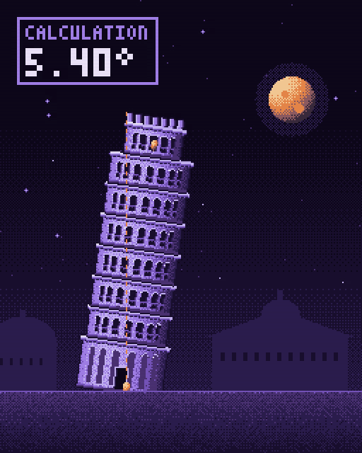
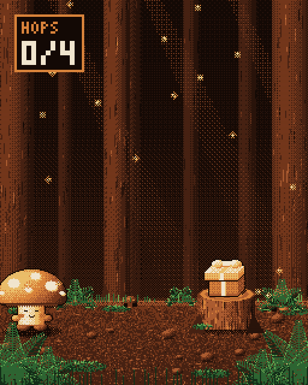
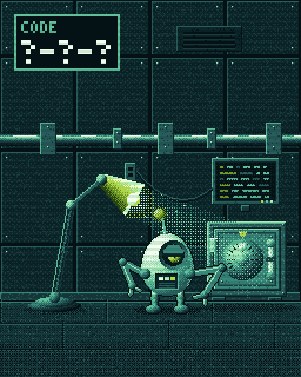
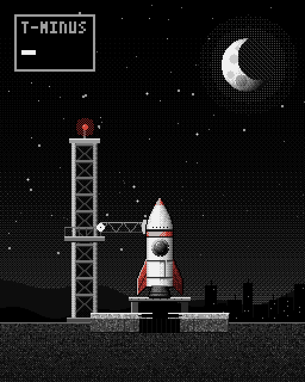
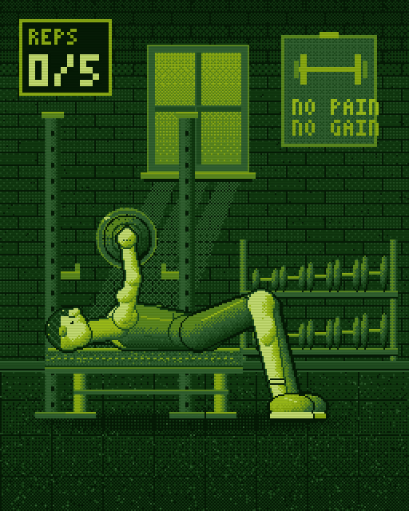

# Pixel Studio

**Make viral pixel-art videos with Claude. Free and open source.**

You describe a scene, and Claude draws every pixel, every physics beat and every sound effect in plain JavaScript. There's no kit to buy, no art skills to learn and nothing to install.

**[▶ See it live at zerowing.in/pixel](https://zerowing.in/pixel/)** · [Open the studio](https://zerowing.in/pixel/studio.html)

<p>
  
  
  
  
  
</p>

The full videos with sound are in [`media/`](media): [Pisa](media/pisa.mp4), [Mushroom Post](media/forest.mp4), [Safe Cracker](media/lab.mp4), [Liftoff](media/rocket.mp4) and [New PR](media/gym.mp4).

## Make your own in three steps

You need [Claude Code](https://claude.com/claude-code), Node 18+, and ffmpeg for MP4 export.

**1. Get the studio and give Claude the skill**

```bash
git clone https://github.com/MuhammadaliMS/pixel-studio
cd pixel-studio
mkdir -p ~/.claude/skills/pixel-studio
cp skill/SKILL.md ~/.claude/skills/pixel-studio/
```

**2. Ask Claude for a scene**

```bash
claude "make a pixel video of the Eiffel Tower melting in a heatwave, ember palette"
```

**3. Export it**

```bash
node tools/render.mjs scenes/eiffel.js --mp4 out/eiffel.mp4
```

That's a 1024×1280 MP4 with sound, ready for Reels, TikTok or Shorts. To preview while you work, run `python3 -m http.server` and open `studio.html`.

## Ideas to try

- a cat slowly pushing a glass off a table
- the Titanic hitting the iceberg, with a depth counter
- a Jenga tower losing one block at a time until it falls
- a dragon slowly waking up on a pile of gold
- a volcano erupting on a tiny island, with a pressure gauge

## What's inside

| Path | What it is |
|---|---|
| `src/pixel.js` | The engine, about 450 lines with no dependencies |
| `scenes/*.js` | One file per animation, each a `PX.scene({ setup, draw })` |
| `skill/SKILL.md` | The rules Claude follows to make scenes look like real pixel art |
| `tools/render.mjs` | Headless renderer that writes PNG frames or an MP4 with sound |
| `index.html` / `studio.html` | Live gallery, and a player with palette swap and recording |

## How it works

| Trick | Where |
|---|---|
| Drawn at 256×320, then scaled up with nearest-neighbour | `Stage.present` |
| Pixels store palette **indices**, so swapping the palette recolours everything | `Buf`, `PX.palettes` |
| 12-colour palettes: an 8-step ramp plus a 4-step accent | `PX.palettes` |
| Lit balls and cylinders with dithered shading bands, plus auto-outlines for characters | `Buf.ball`, `Buf.cyl`, `Buf.outline` |
| Rotation without blur (nearest-neighbour inverse mapping) | `Buf.blitRot` |
| Bayer ordered dithering in place of alpha (dust, glow, fades) | `Buf.dither`, `ditherCircle` |
| 12 fps stepped time, which gives the hand-animated feel | `PX.player` |
| Physics precomputed in `setup()`, so every frame is deterministic | `scenes/pisa.js` |
| CRT scanlines, flash, shake, row-shift glitch | `present` fx, `Buf.rowShift` |
| Chiptune SFX synthesised in code (no audio files), in the browser and in MP4 exports | `PX.SFX` |

Studio URL options: `?scene=2`, `?t=3.2` (freeze on a moment), `?palette=ember`.

## License

MIT
